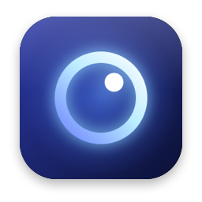
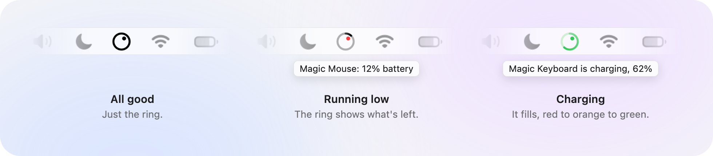
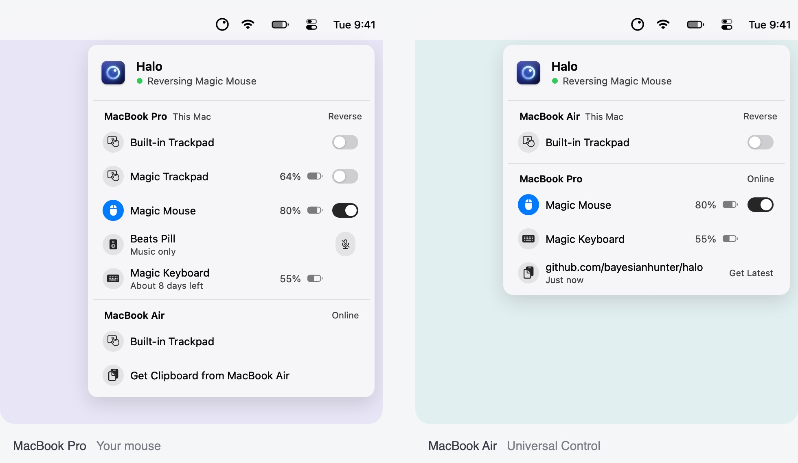
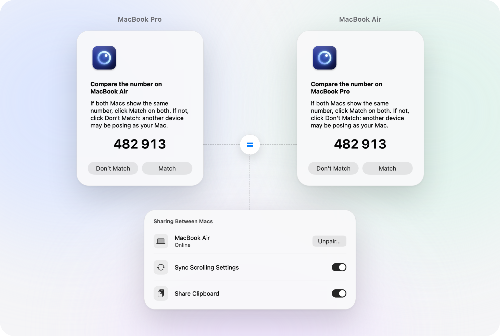

<h1 align="center">Halo</h1>

Everything you connect, looked after.

<strong>Halo for Mac</strong> is a free, open-source menu bar app. Reverse your mouse while your trackpad stays natural, see your peripherals’ batteries, and keep scrolling settings and your clipboard in step across two Macs, from the menu bar or from your AI agent.

<code>brew install --cask bayesianhunter/tap/halo</code>

macOS 26+ · Apple silicon · GPL-3.0 · <a href="https://github.com/bayesianhunter/halo/releases">Download</a>

https://github.com/user-attachments/assets/2aa22e10-7f1d-403d-aee5-70ea875cea0b

<h2 id="on-your-mac">On your Mac</h2>

<strong>Scrolling that feels right.</strong> Reverse your mouse and keep your trackpad natural. Set each device separately, with 0.5×–4× speed for mouse wheels. Works in iPhone Mirroring too.

<strong>Batteries at a glance.</strong> See the charge of your mouse, keyboard, trackpad and Bluetooth audio, with time-left estimates where available.

  <picture>
    <source media="(prefers-color-scheme: dark)" srcset="docs/menubar-dark.png">
    
  </picture>

<strong>Speakers stay speakers.</strong> Keep macOS from using your Bluetooth speaker as the microphone, so music stays at full quality.

<h2 id="across-two-macs">Across two Macs</h2>

Halo recognizes the mouse and trackpad that Universal Control brings to the other Mac, with a separate scrolling rule for each.

  <picture>
    <source media="(prefers-color-scheme: dark)" srcset="docs/uc-dark.jpg">
    
  </picture>

Pair Halo on both Macs to see each other’s devices, sync scrolling settings, and let text and images follow your pointer.

Pair two Macs

<ol>
  <li>Install Halo on both Macs and keep them on the same network.</li>
  <li>Choose <strong>Pair…</strong> on both. Leave the sharing options you want selected.</li>
  <li>Compare the six digits. If they match, click <strong>Match</strong> on both.</li>
</ol>

If the digits differ, choose <strong>Don’t Match</strong>.

  <picture>
    <source media="(prefers-color-scheme: dark)" srcset="docs/pair-dark.png">
    
  </picture>

<h2 id="know-what-happened">Know what happened</h2>

When a peripheral stops behaving, ask your coding agent. Halo gives it live diagnostics, 30 days of events, and checks it can run on demand.

<table>
  <thead><tr><th>You ask</th><th>Halo provides</th></tr></thead>
  <tbody>
    <tr><td>What happened to my mouse?</td><td>Connection and Universal Control events.</td></tr>
    <tr><td>Why is my speaker cutting out?</td><td>A check of the Bluetooth audio link.</td></tr>
    <tr><td>Why can’t my Macs connect?</td><td>A connection check between the paired Macs.</td></tr>
  </tbody>
</table>

Your agent can also change scrolling direction, wheel speed and the speaker microphone rule. Halo shows a notification for every change.

Add the <a href="packaging/AgentSkill/SKILL.md">Agent Skill</a> from <strong>Diagnostics</strong>, or copy a diagnostics summary into your chat.

Agent commands

<pre><code>halo --diagnostics
halo --events --since 1h
halo --diagnostics --audio-check
halo --diagnostics --link-check
halo --set speed &lt;id&gt; 1.5</code></pre>

<h2 id="get-started">Get started</h2>

Install with Homebrew above, or download the app from <a href="https://github.com/bayesianhunter/halo/releases">Releases</a>.

<ol>
  <li>Open Halo. Allow it in <strong>System Settings → Privacy &amp; Security → Accessibility</strong>.</li>
  <li>Turn on <strong>Reverse</strong> for the mouse or trackpad you want to change. Everything starts unchanged.</li>
</ol>

Set up with your coding agent

Copy this request into your agent:

<pre><code>Install Halo from https://github.com/bayesianhunter/halo
(brew install --cask bayesianhunter/tap/halo).
Open the app and ask me to allow Accessibility access.
Wait for me to confirm it is allowed.
Link /Applications/Halo.app/Contents/Resources/AgentSkill as halo in your
skills folder (~/.claude/skills or ~/.agents/skills), then read its SKILL.md.
If a halo skill is already there, ask me first.
Run halo --diagnostics and show me the devices before changing any settings.</code></pre>

<h2 id="clean-in-clean-out">Clean in, clean out</h2>

Halo keeps its data in one folder, <code>~/Library/Application Support/Halo</code>, beside its preferences and the caches macOS keeps for every app. It doesn’t start at login unless you turn that on, and it links the Agent Skill only when you ask.

<strong>Settings → General → Uninstall Halo…</strong> lists everything Halo has put on your Mac, then takes it all away: it unpairs (telling the other Mac if it’s connected), deletes the pairing key, turns off Open at Login, removes its Agent Skill links, moves its files and the app to the Trash, and quits. Anything it couldn’t remove, it tells you. macOS keeps its own lists in Privacy &amp; Security and Notifications until you remove Halo there, so Halo opens Privacy &amp; Security on its way out.

Installed with Homebrew? Uninstall in Halo, then run <code>brew uninstall --cask halo</code>. <code>halo --uninstall</code> prints the same list without removing anything.

<h2 id="faq">FAQ</h2>

<h3>How do I reverse mouse scrolling but keep the trackpad natural on a Mac?</h3>

macOS has one Natural scrolling setting, shared by every mouse and trackpad. Halo sets each device separately: turn on <strong>Reverse</strong> for your mouse and leave the trackpad unchanged.

<h3>How do I keep different scroll directions for my mouse and trackpad with Universal Control?</h3>

With Universal Control, the mouse and trackpad from your other Mac arrive as separate devices. Halo recognizes them and gives each its own rule, so the mouse stays reversed and the trackpad natural on whichever Mac the pointer is on. Pair the two Macs to keep these settings in sync.

<h3>Why does my Bluetooth speaker suddenly sound bad on my Mac?</h3>

A Bluetooth speaker used as a microphone drops to call quality for as long as anything records. macOS can make a speaker the microphone when it reconnects; Halo switches the input back to the Mac’s own microphone. If an app picks the speaker’s microphone itself, Halo can’t change that, but it tells you, naming the app when it can.

<h3>How can I see the battery of my mouse, keyboard and trackpad on a Mac?</h3>

Halo shows the charge of mice, keyboards, trackpads and Bluetooth audio devices that report a battery, in its menu. It also reads the standard Bluetooth Low Energy battery of mice and keyboards, such as the Logitech MX Master 2S we test with. For devices that report fine-grained levels, it estimates the time left after a day of readings.

<h3>Can my AI agent check or change my peripherals?</h3>

Yes. Halo includes an Agent Skill and a <code>halo</code> command. Your agent can read live diagnostics and 30 days of events, run Bluetooth audio and connection checks, and change scrolling direction, wheel speed and the speaker microphone rule. Halo shows a notification for every change.

<h3>Which Macs does Halo run on?</h3>

macOS 26 or later on Apple silicon. Halo is free and open source under GPL-3.0.

<h2 id="feedback">Feedback</h2>

Something not right, or an idea? <a href="https://github.com/bayesianhunter/halo/issues">Open an issue</a>, or email <a href="mailto:milky.eggy.app@gmail.com">milky.eggy.app@gmail.com</a>. In Halo, <strong>Settings → About → Send Feedback…</strong> starts either one with your Halo and macOS versions written in, and clicking the version at the top of the menu copies them.

<h2 id="privacy">Privacy</h2>

Halo talks only to the Mac you pair with and, if you allow it, checks halo.liuzhekan.com for updates once a day. No keystrokes, screen content or microphone audio is recorded. Shared clipboard contents stay in memory, not in a history on disk. <a href="SECURITY.md">Security and privacy details</a>.

Build from source

Requires Xcode 26 or later.

<pre><code>scripts/build-app.sh --install
swift test --disable-sandbox</code></pre>

<a href="CONTRIBUTING.md">Contributing</a> · <a href="SECURITY.md">Security</a> · <a href="CHANGELOG.md">Changelog</a>

The idea of identifying each scroll by its HID sender came from <a href="https://pilotmoon.com/scrollreverser/">Scroll Reverser</a> by Nick Moore (Apache-2.0). Updates by <a href="https://sparkle-project.org">Sparkle</a> (MIT; license text in the app).

© 2026 Beijing Bayesian Hunter Technology Co., Ltd · <a href="LICENSE">GPL-3.0</a>

